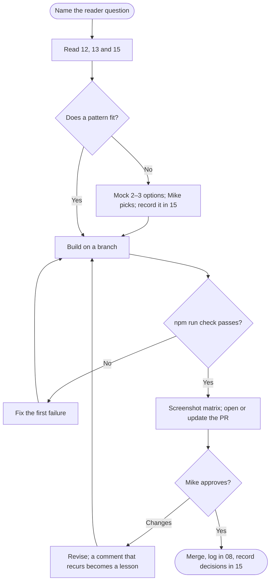

# UI Workflow and QA

The process for any change to how the site looks. Modelled on the agent workflow
in `uts-deck-kit`.

| Step | What to do | What the next agent can inspect |
| --- | --- | --- |
| Scope | Name the reader (recruiter, hiring manager, interviewer) and the question | The PR description |
| Rules | Read the guideline, patterns and decisions; check the current site | — |
| Build | Change tokens in `index.css`, never literals in components | The diff |
| Check | `npm run check`, which includes `ui-audit` | Check output in the PR |
| Screenshots | The matrix below, after scrolling so animations settle | Images in the PR or the shared folder |
| Review | Mike reviews; merging to `main` deploys | PR comments |
| Record | Agent log entry; new decisions in 15; recurring comments as lessons | `docs/08`, `docs/15` |

## Automated checks

`npm run check` runs link validation, `ui-audit`, ESLint, `tsc`, the tests and a
production build. `scripts/ui-audit.mjs` fails on:

- hex or `rgb()` colours in `src/` outside `src/index.css`;
- `shadow-*`, `bg-gradient-*`, `from-*`/`to-*` gradient stops, `backdrop-blur`
  and `blur-*` classes;
- `rounded-*` classes other than `rounded-none` and `rounded-full` (avatars);
- a static `firebase` import outside the dynamically loaded modules.

## Screenshot matrix

| Pages | Themes | Widths |
| --- | --- | --- |
| Home, Projects, Experience, Blog, Contact, 404 | Light, dark | 1440, 390 |

Check hierarchy, overlap, clipping, wrapping, one accent per screen, and that
nothing reads as decoration.

## What the checks don't prove

They don't prove the copy is true, the ranking is right, or that a recruiter
finds what they need. Those stay with Mike's review.

## Lessons

A review comment that might become a rule goes to `docs/working/ui-lessons/` as
`YYYY-MM-DD-topic.md` with: status (proposed), the symptom, before and after, the
proposed rule and its scope. It becomes a rule only after Mike approves it; then
it moves into 12 or 13 and is noted in 15. A comment that recurs twice should
also become a `ui-audit` check where it can be checked mechanically.
